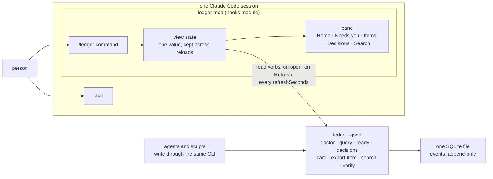

# mods

[](LICENSE)

Claude Code mods: panes that sit beside the chat in a Claude Code session and draw what a person needs to see while an agent works. Each mod is its own plugin and installs on its own. The first is `ledger`, a read-only pane over an append-only item ledger.

## Why

A Claude Code session is a conversation, and a conversation is a poor place to keep state. The things a person wants to glance at while an agent works, such as what is waiting on them, what moved since they last looked, and what was decided and on which words, are either asked for again and again, which costs a turn and some of the context window each time, or scrolled past and forgotten. A pane that stays open beside the chat and re-reads its source on a timer answers those questions without a prompt.

Claude Code's plugin system lets a plugin ship a hooks module: code the engine loads into every session, which can open a pane, draw it from the engine's own elements, register a slash command and run a process. That is what a mod here is. It runs in the engine, not in the model's context, so an open pane costs the conversation nothing.

The mods here support one way of working: a person and several agents sharing a body of work whose record is kept as events in a ledger. What the pane shows is derived from the same log the agents write to, never from a copy of it.

## What this is

One marketplace file at the root and one plugin folder per mod. A mod runs hooks in every session it is installed in and carries its own options, so you install only the mods you want, each by name.

| Mod | What it draws | Reads |
| --- | --- | --- |
| `ledger` | A `/ledger` pane: what needs you, every item, one item's card and log, the decisions and the words they rest on, and a search. | The [ledger](https://github.com/smithadifd/ledger) CLI, read verbs only. |

The difference is in how each mod is built. Every mod ships its tests, which `claude plugin test` runs against the engine itself; type-checks against the engine's own declarations; and passes `claude plugin validate --strict`. Every change is reviewed before merge by a reviewer with no context of the build, and code changes also by a second model family, with the guarded line reverted and the test shown failing. A mod that reads a person's data runs a fixed list of read commands and nothing else: for `ledger` the list is code, and a test proves that a write verb cannot be built.

## How it fits together



The pane never opens the database file. It runs the ledger CLI with `--json`, reads the envelope and draws. The ledger's own rule, that the CLI is the only door, holds for the viewer as it does for the writers. Whatever the pane shows is a projection of the events, re-read on a timer, and the item screen keeps the ledger's own footer saying so.

## Install

You need Claude Code 2.1.275 or later and `git`. At the prompt of a terminal session:

```text
/plugin install ledger --marketplace smithadifd/mods
```

Answer `y` to add the marketplace, pick the scope (user, to have it in every session), and set the options when asked. From a shell, the same install is:

```sh
claude plugin install ledger --marketplace smithadifd/mods
```

or, in two steps, `claude plugin marketplace add smithadifd/mods` then `claude plugin install ledger@mods`. Update with `claude plugin update ledger`. In the desktop app, where `/plugin` does not run, click + next to the prompt box, then Plugins, Add marketplace with `smithadifd/mods`, then Add plugin.

To run a mod from a clone instead, with a reload on every save, start a session with `claude --plugin-dir ~/code/mods/ledger`, or name the folder in `CLAUDE_CODE_PLUGIN_DIRS` in the `env` block of `~/.claude/settings.json`; the mod's options then live under `pluginConfigs.ledger.options` in the same file. Use one route, not both: a session that loads the same mod twice refuses the second `/ledger`.

## The ledger mod

[The ledger](https://github.com/smithadifd/ledger) keeps the work items of one body of work, the questions asked about them and the decisions taken, as events in one SQLite file written through one CLI by people and agents alike. A person opening `/ledger` has three questions, and the pane answers them in that order: what needs me, what is moving, and what was decided, on which words.

### Screens

Five tabs, each with a hotkey, and `/ledger <word>` opens straight to one:

- **Home** (`h`). The database path and schema from `doctor`; the chain (`v` runs `verify`, and the result and when it ran stay on screen); the state of the search index; one stacked bar per item type, split by status and scaled to the largest type, with a legend in words; four tiles (ready, blocked, open decisions, claimed) that open the list under that filter; a sparkline of items touched per day over the last 30 days; and the items claimed now.
- **Needs you** (`u`). Open decisions oldest first, then blocked items, then claims held, then claims that have outlived their lease. Each row opens the item.
- **Items** (`i`). Every item, claimed first, then open, blocked and closed, newest first within a status, each with its age, id, claim (its type when unclaimed) and title. Filters by type and by status, where `ready` is the ledger's own unblocked set. Paged to the pane's height; `j` and `k` turn the pages.
- **Item** (from any row). Under the tab row, a strip of the item's sections, each with a hotkey and a count (`–` when empty): Now (`n`), Decisions (`e`), Links (`l`), Timeline (`t`), Spec (`p`) and, only when the item carries /ticket pass notes, Ticket (`g`). A section's button scrolls the pane to it. A header line says where the item was minted from, the day, and when a claim's lease ends. **Now** answers where the item is and what it waits on: the next step, the latest stop stamp (phase, point, skills, refs), open questions with every option and the recommended one marked, blockers as rows that open the item, and the claim with its lease in words, in the error colour once it ended, then the item's sessions: each distinct session its events and `session` links name, once, the one named by the latest event first, with a **Copy resume line** button that copies `claude --resume <session>` (`no sessions recorded` when there is none). A session id is usable only when it is a string of at most 128 characters that starts with a letter or digit and holds only letters, digits and `. _ : -`; anything else (empty, not a string, a space, shell syntax such as `$(...)`, `;`, `|`, `&`, `<`, `>`, quotes or a backslash, a leading `-`, too long, non-ASCII) shows `session id unusable` and offers no copy. An expanded timeline row and a `session` link offer the same copy. The pane only copies the text; it starts no program and writes nothing. **Decisions** has every election (the chosen option, the rejected ones, scope, the quote it rests on and a grant's id), the asks they answered, and decision records with their latest standing and result. **Links** groups every link by relation, a pull request as `repo#number`, an item link with its status glyph and title, a `url` target with a copy button; related items and documents print one line saying what they wait on. **Timeline** is every event, newest first under day lines, with a loop step and its completion folded into one row carrying its round and how long it ran; Enter or a click expands a row to its payload and its provenance (actor, harness, model, session, time to the second, idempotency key, hash), and the expansion survives a re-read; a kind filter and an oldest-first toggle narrow and turn it, and past 40 rows only the rows near the window are drawn in full, so no row is dropped. **Spec** shows the current spec version (its size, merge class, source and rev, and `spec moved` when the item's claim was taken against an older version) with its body and acceptance criteria drawn as Markdown wrapped to the pane, then every earlier version newest first, one line each (version, day, size, event id); Enter or a click on an earlier version expands it to its own body, from the events the pane already holds, and an event with no string body says `body not recorded`. The strip's Spec count is the number of versions. From the ledger's resume card come only what the ledger alone derives: next step, open questions, blockers, progress and duplicated-by. Everything else is drawn from the item's own events (`export-item`), so the card's word bound cannot hide it. If the events cannot be read, each section they feed says so and the card's sections stand; if a re-read is refused, the last good detail stays on screen, dimmed, with the age of the read it shows. The pane reads its width on every draw: under 70 columns the header stacks and timeline rows put their summary on a second line, from 120 the timeline adds the model and the time to the second. Keys: `x` back to the list, `c` copies the id, `a` and `f` step to the previous and next item in the list the item was opened from, `b` goes back through items opened from one another, `o` copies the first PR link (or, with none, the first url), and `n e l t p g` jump to a section. (The engine takes only a digit or a lowercase letter as a hotkey, so the step keys are letters.)
- **Decisions** (`d`). Every decision record, newest first: standing, day, who, item and effect. A row expands to the verbatim words the decision rests on, who recorded it and as what, the tags, and what superseded it. Filter by standing.
- **Search** (`s`). A field over the ledger's own index; a hit on an item opens it.

`/ledger NY-148` opens an item, and a word that names no item is searched for; `/ledger merge train` searches; `/ledger blocked` (or `ready`, `open`, `claimed`, `closed`) lists under that status; `/ledger needs` opens Needs you. `r` re-reads at any time. A pane opened on a path with no database yet draws the ledger's quick start instead of an error, and reads again when you press Refresh.

### Options

Set when the mod is installed, and afterwards in `/config` (or, for a `--plugin-dir` load, under `pluginConfigs.ledger.options` in `~/.claude/settings.json`):

| Option | Default | What it is |
| --- | --- | --- |
| `command` | `ledger` | How to run the ledger CLI: `ledger` when it is on `PATH`, or `python3 -m ledger` with `folder` set. |
| `folder` | empty | The working directory for the command, for `python3 -m ledger` from a clone or a vendored copy. Empty runs it from the session's own directory. |
| `db` | empty | The database path. Empty leaves it to `LEDGER_DB` in the session's environment, as the CLI reads it. |
| `refreshSeconds` | `60` | How often the open pane re-reads. `0` reads only on open and on Refresh. The timer skips the Search screen, so a re-read never clears what you are typing. |

The mod needs ledger 0.1.5 or newer and runs it in the session's own environment, so a `LEDGER_DB` set for the session is enough. It runs eight verbs, all reads: `doctor`, `query`, `ready`, `decisions`, `card`, `export-item`, `search` and `verify`. Nothing in the mod appends an event. The verbs it can build are the list `READ_VERBS` in `ledger/hooks/cli.ts`, and a test proves that a write verb throws.

### Colors and glyphs

Status and standing are drawn with the engine's theme keys, so the pane follows the person's own theme in light and dark. Each is also told by a glyph, so color is never the only carrier of meaning: `●` open, `◆` claimed, `✖` blocked and `○` closed for items; `●` settled, `◐` lean and `○` superseded for decisions. The bars on Home carry a legend in words.

## Writing a mod

A mod is a folder with three files: `.claude-plugin/plugin.json` (its name, version, description and `userConfig` options), `hooks/hooks.json` naming the module, and the module itself, `hooks/register.tsx`, which exports `register` and receives `on` for its hooks and `options` for the person's settings. A mod that keeps state adds `types/index.d.ts`. The `plugin-authoring` skill that ships with Claude Code documents the whole interface. The engine writes the API's TypeScript declarations beside a mod each time an interactive session loads it, into `.claude-plugin/types/`, which is why that folder is ignored here.

To add a mod to this repository:

1. Put it in its own folder at the root, named for the mod, with its tests in `tests/` as `*.test.ts` or `*.test.tsx`.
2. Add an entry to `.claude-plugin/marketplace.json` with `"source": "./<mod>"`.
3. Run the three checks from a machine where a session has loaded the mod (`claude --plugin-dir ./<mod>`), so the declarations are in place:

```sh
claude plugin validate --strict <mod>
tsc -p <mod>              # TypeScript 5.4 or newer
claude plugin test <mod>
```

No hard-coded paths: options and the environment carry what differs between machines, and a mod works against an empty source.

## How it is built

- **Tests beside the code.** Each mod's `tests/` run under `claude plugin test` against the engine itself, with the mod's hooks above the test's own `$`. The pane's tests mount it, press its buttons, type into its field and read the tree back, on the terminal and desktop surfaces alike, and seed a value an earlier version stored to show it is declined. The `ledger` mod has 115 tests across its CLI parsing, its model and its pane.
- **The engine's own declarations.** `tsc -p <mod>` type-checks against the API as the engine wrote it beside the mod, under `strict` and `noUncheckedIndexedAccess`.
- **CI runs what it can.** On every push and pull request: `claude plugin validate --strict` on the marketplace and on each mod, then `claude plugin test` on each mod, under the Claude Code version the mods were built against. The type-check runs on a developer's machine: the declarations it needs are written only by an interactive session, so a runner has none to check against.
- **Read-only by construction.** A mod that reads a person's data runs a fixed list of read commands and nothing else. The list is code, and a test tries a write.
- **Review before merge.** Every change is reviewed by a reviewer with no context of the build, and code changes also by a second model family. A fix lands with mutation evidence in its pull request: the guarded line reverted, the test shown failing, then passing again with the fix restored.

## Status and roadmap

`ledger` 0.1.0 (see [CHANGELOG.md](CHANGELOG.md)), built and tested on Claude Code 2.1.318. The hooks-module interface is in early access on current builds and may change between releases; a mod here is checked against the build CI names.

In motion, in rough order:

- **Activity from events.** The Home sparkline counts items by the day of their newest event. When the ledger grows an `events` verb across items, it will count events per day, and the item log will become a feed.
- **Open questions across items.** Needs you lists open decision items. A `questions` verb on the ledger side will let it list every open ask with its item, who asked and how long it has waited, without one `card` per item.
- **Actions.** Answering an open question, adding a note, closing or reopening an item and linking a document, each through the CLI, each behind a visible confirm, each stamped so the ledger says a pane wrote it, and all opt-in. Never claiming an item: that is the work loop's.
- **More mods.** A context and plan-window meter for the status line is the next to move here.

## Built on

Little here is new. Each line names what this repository took from the source.

- [Claude Code plugins](https://code.claude.com/docs/en/plugins): the manifest, the marketplace file and the install road. The hooks module a mod is, with its `on(event, hook)` chain, `$.ui.open`, the `ui.render` tree and `$.process.run`, is Claude Code's own interface for code that runs in the engine, documented by the `plugin-authoring` skill that ships with it.
- [The ledger](https://github.com/smithadifd/ledger): the events, the `--json` envelope and the rule that the CLI is the only door, which the viewer keeps.
- [Edward Tufte, *Beautiful Evidence*](https://www.edwardtufte.com/tufte/books_be) (2006): sparklines, small word-sized graphics set in a line of text, which is what the activity line and the type bars are. The pane keeps the numbers beside them.
- [WCAG 2.2, Use of Color](https://www.w3.org/TR/WCAG22/#use-of-color): color is never the only way a status is told; each colored glyph has its own shape, and the legend has words.
- The engine's theme keys rather than a palette of the mod's own, so a pane reads as part of the session in light and dark.

## Contributing and support

To report a problem or ask a question, open an issue on the repository's GitHub issue tracker. Say which mod it concerns, the Claude Code version (`claude --version`), what you ran, what you expected and what happened; for the `ledger` mod, the output of `ledger --json doctor` helps. Report a security problem privately instead, as [SECURITY.md](SECURITY.md) describes.

To propose a change, open a pull request from a branch. Keep it to one change, and add or update a test that fails without it. Before you ask for review, `claude plugin validate --strict <mod>`, `tsc -p <mod>` and `claude plugin test <mod>` must pass.

## License

MIT. See [LICENSE](LICENSE).
